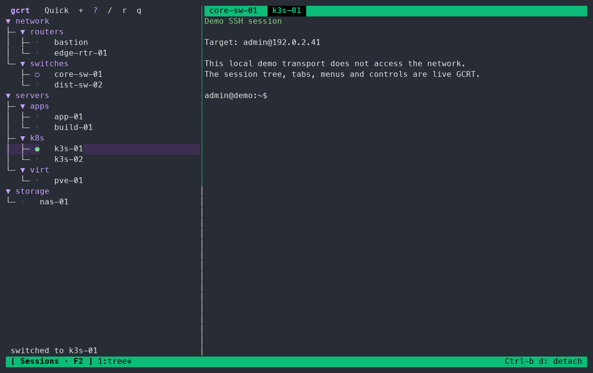
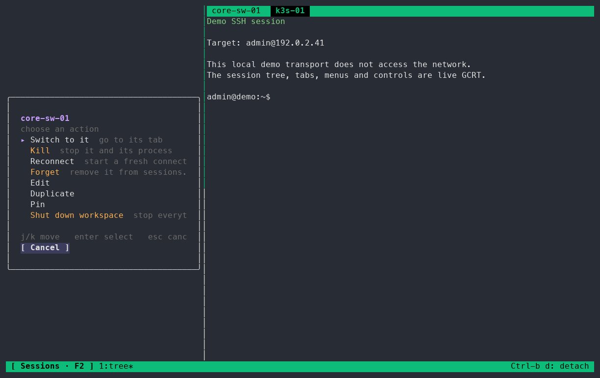
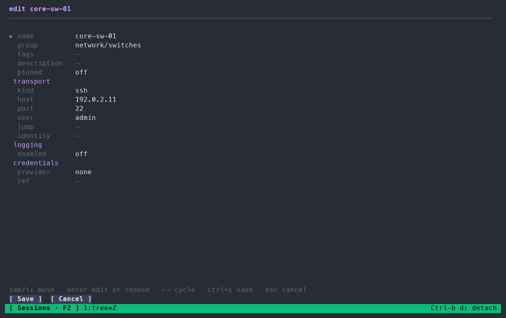
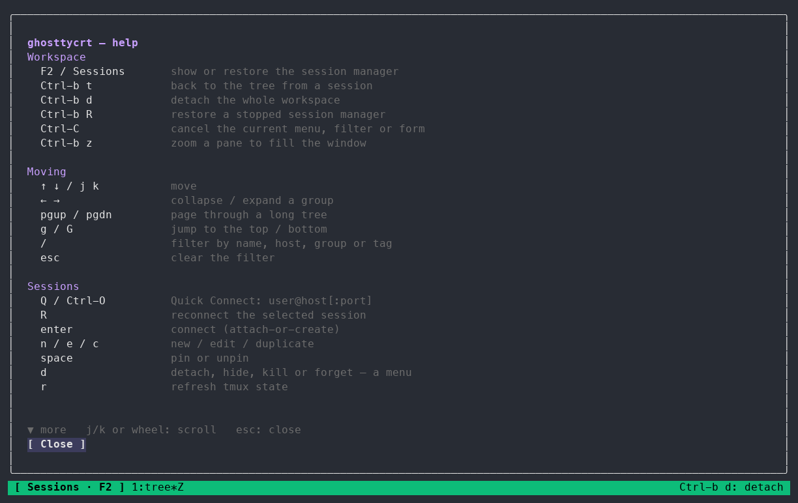
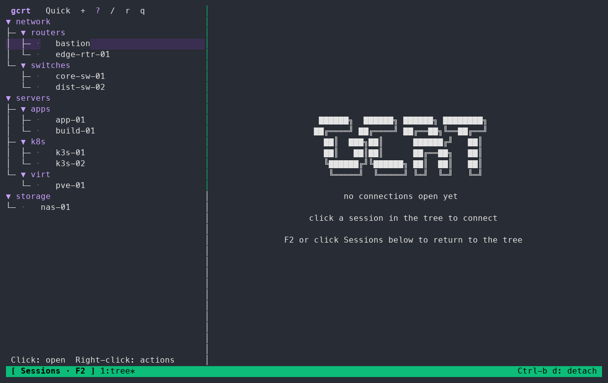

# ghosttycrt

A terminal session manager for network gear and servers — SSH, serial console,
session tree, and logging in one TUI, hosted on Ghostty.

Replaces SecureCRT for the parts that actually get used daily, and stays out of
the terminal-emulator business because Ghostty already does that better.

**Status:** SSH session management with workspace recovery, Quick Connect and
reconnect. SecureCRT ease-of-use parity is still in progress. `enter` creates
or reattaches a tmux session and hands
you the terminal; the session outlives `gcrt` and Ghostty. With
`display_mode = "workspace"` the tree lives in a tmux window of its own and
every connection gets its own tab (`workspace_layout = "tabs"`), or the tree
stays pinned on the left with the tabs beside it (`"sidebar"`), or connections
tile as panes when you want several visible at once (`"split"`). The top row is a clickable menu bar; `?` or the
`Help` item opens the full key and command list. The mouse highlights whatever
it is over, and clicking a host opens it. Sessions can be created,
edited, duplicated, pinned and removed from the UI, with atomic writes to
`sessions.toml`. Serial and logging are next
([`spec/09-milestones.md`](spec/09-milestones.md)).

## Everyday controls

| Action | Control |
|---|---|
| Show or restore the session manager | Click **Sessions · F2** on the bottom bar, or press `F2` |
| Quick Connect | Click **Quick** in the tree header, or press `Q` / `Ctrl-O` |
| New saved session | Click **+** (**New** in a wide pane), or press `n` |
| Edit, duplicate, pin or remove a session | Right-click its tree entry and choose the action |
| Reconnect a saved session | Select it and press `R`, or choose **Reconnect** from its right-click menu |
| Reconnect an open tab | Right-click its tab and choose **Reconnect** |
| Save or leave an editor/dialog | Click **Save**, **Cancel**, **Close** or **No**; keyboard shortcuts still work |
| Leave connections running and close the workspace view | `q` from the tree, or `Ctrl-b d` |

Quick Connect accepts `host`, `user@host`, `host:2222`, and
`user@[2001:db8::1]:2222`. New addresses are saved under **Quick Connect**;
matching saved sessions reuse their settings. SSH still handles authentication
through its agent, SSH config, key file or password prompt.

A reconnect interrupts the selected connection, so a live connection asks for
confirmation. Other connections stay open. A disconnected saved session can be
reconnected directly.

Confirmations have clickable **Yes** and **No** buttons. Pressing Enter in a
confirmation cancels; blank space beside a button cannot activate it. Tab
reconnect/close confirmations are mouse menus too. Use the wheel to scroll a
short menu or editor; its action buttons stay visible.

The idle logo is static, with a hidden cursor. It redraws only when the pane is
resized or returns from a connection. An existing workspace updates its display
wrapper when the session manager starts with a new build, preserving SSH tabs.

Reopening `gcrt` restores a stopped tree before attaching. From another terminal,
`gcrt recover` restores and focuses the tree without attaching that terminal.
Both preserve running connections. `Ctrl-b t` and `Ctrl-b R` also restore a
stopped tree; they leave a healthy tree running, including unsaved forms.

## Screenshots

The sidebar layout — the tree stays put, connections are tabs beside it:



Right-clicking a session opens its menu, where it can be closed:



Sessions are added and edited in place; saving writes the file atomically:



`?` brings up every key and command:



With nothing open, the content pane says so:



These are generated by `scripts/screenshots.sh`, which drives a real `gcrt`
against a throwaway config with invented hosts and a stand-in for `ssh` — so no
real session appears in them.

## Build and run

On macOS, install an application launcher after installing `gcrt`:

```sh
bash scripts/install-macos-launcher.sh
```

This creates `~/Applications/GCRT.app` with its own icon. Open **GCRT** from
Spotlight or Finder, or drag the app into the Dock. It opens the saved workspace,
reusing any running connections. It bundles a private copy of Ghostty under
GCRT's own app identity, so its Dock icon stays separate from ordinary Ghostty.
The launcher uses the installed `gcrt`, so future binary updates do not require
rebuilding it. To update the bundled terminal after upgrading Ghostty, move the
old GCRT.app aside and run the installer again. Automatic Ghostty updates are
disabled inside GCRT to preserve its app identity.

```
go build ./cmd/gcrt          # or: go run ./cmd/gcrt tui
go run ./cmd/gcrt check      # validate config + sessions, no TUI
go run ./cmd/gcrt import securecrt           # dry run
go run ./cmd/gcrt import securecrt --write   # replaces sessions.toml, after a backup
go test ./...
```

For the tab-menu mouse regression check, build `gcrt` and run
`python3 scripts/check-menu-mouse.py /absolute/path/to/gcrt`. It uses private
configuration and tmux sockets with fake SSH processes, and checks pointer
movement, cancellation, and closing only the chosen session.

`gcrt` reads `~/.config/ghosttycrt/{config.toml,sessions.toml}`. Point it
elsewhere while trying it out with `-config-dir examples`.

`gcrt import securecrt` converts an existing SecureCRT configuration — its
folder tree becomes the group tree, and stored passwords are never imported
(sessions that had one are listed so you can add a credential reference).

## The shape of it

```
Ghostty  →  gcrt (TUI session manager)  →  tmux (session host)  →  ssh / picocom
```

- **Ghostty** renders. Native tabs/splits on macOS; any window on Linux.
- **gcrt** is the session tree, the launcher, and the log switch.
- **tmux** is the portable backbone: same on macOS and Linux, survives Ghostty
  quitting or the laptop sleeping, and gives us per-session logging for free.
- Credentials come from **Infisical** or **Vaultwarden** at connect time and are
  never written to disk.

## Non-goals

SFTP/SCP panels, X/Y/Zmodem, Wyse/SCO emulation, RDP/VNC, a password vault of
our own, AI. See `spec/01-overview.md`.

## Prerequisites

| | |
|---|---|
| Ghostty | 1.3.0+ (1.3.1 verified) |
| tmux | installed (3.7c) |
| Go | 1.26+ (verified go1.26.5 darwin/arm64) |
| picocom | installed — serial only |
| infisical CLI | credential provider (installed at `~/.local/bin/infisical`) |
| rbw | credential provider for Vaultwarden — `brew install rbw` |

## Spec index

| File | Covers |
|---|---|
| [`spec/README.md`](spec/README.md) | index, decisions, open questions |
| [`spec/01-overview.md`](spec/01-overview.md) | problem, goals, non-goals, users |
| [`spec/02-architecture.md`](spec/02-architecture.md) | layers, why tmux, process model, paths |
| [`spec/03-data-model.md`](spec/03-data-model.md) | config, session records, state, imports |
| [`spec/04-transports.md`](spec/04-transports.md) | ssh, serial, telnet, local; attach/detach |
| [`spec/05-credentials.md`](spec/05-credentials.md) | Infisical, Vaultwarden, askpass, macros |
| [`spec/06-logging.md`](spec/06-logging.md) | pipe-pane, timestamps, rotation, viewer |
| [`spec/07-tui.md`](spec/07-tui.md) | views, keybinds, status, theming |
| [`spec/08-acceptance.md`](spec/08-acceptance.md) | acceptance criteria and test list |
| [`spec/09-milestones.md`](spec/09-milestones.md) | M0–M6 build order |
